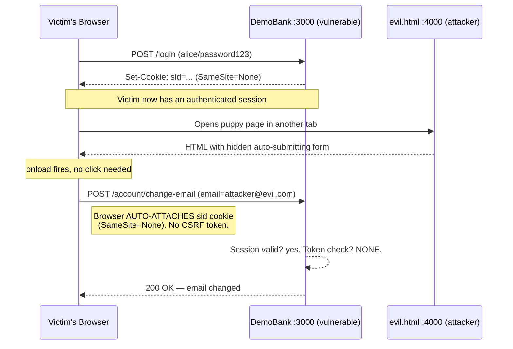

# CSRF Lab - Build It Vulnerable, Attack It, Then Defend It

> A self-contained teaching lab. Everything runs locally. The attacker page
> targets **only this repo's own server** — a closed lab, never a real system.

## 1. Overview

This project is a hands-on lab about **Cross-Site Request Forgery (CSRF)**. It
ships the *same* small "DemoBank" web app in two builds: a **vulnerable** one
with no CSRF protection, and a **secure** one hardened with a hand-rolled
synchronizer token plus cookie and Origin defenses. A third piece — an
attacker-controlled page on a different origin — auto-submits a forged request
that silently changes the logged-in victim's email address. You run the attack
against both builds and watch it **succeed on the vulnerable server and fail
(HTTP 403) on the secure one**. The goal is to *feel* why cookies alone can't
authenticate a state change, and to see exactly which line of code closes the
hole.

## 2. Learning Objectives

Mapped to the assignment statement:

| # | Objective | Where it's demonstrated |
|---|-----------|-------------------------|
| 1 | Build a CSRF-vulnerable state-changing form | [`vulnerable/`](vulnerable/) — `POST /account/change-email` |
| 2 | Demonstrate a working CSRF attack | [`attacker/evil.html`](attacker/evil.html) + §7 real output |
| 3 | Implement CSRF tokens that stop the attack | [`secure/`](secure/) — synchronizer token, tagged `// FIX:` |
| 4 | Understand the root cause | §3, §7 (server trusts the session cookie alone) |
| 5 | Apply defense-in-depth (SameSite, Origin, HttpOnly) | [`secure/server.js`](secure/server.js) + §8 |
| 6 | Map each weakness to its fix and verify | §9 summary table + captured 403s |

## 3. What Is CSRF (Plain English)

When you log into a site, the server hands your browser a **session cookie**.
From then on your browser attaches that cookie to **every** request it sends to
that site — automatically, no matter *what caused the request*. A click on a
link, a form submit, an image load, a `fetch()` — the cookie rides along.

CSRF abuses exactly this. A malicious page on a *different* website can tell your
browser to send a request to the bank ("change email to attacker@evil.com").
Your browser, being helpful, attaches your bank cookie. The bank sees a
valid session and does it. You never clicked anything on the bank; the request
was **forged** by another site, using your ambient authority.

**Why cookies make it possible:** cookies are *ambient* credentials — they are
sent based on the request's *destination*, not on who *initiated* it. The server
receiving a cookie cannot, on the cookie alone, tell "my own form submitted
this" from "some other site tricked the browser into submitting this." That
ambiguity is the entire vulnerability. The fix is to require a credential the
attacker's site **cannot obtain or guess** — a per-session random token that
lives in the page, not in an auto-sent cookie.

## 4. Architecture & Flow

### 4a. The attack (vulnerable server)



### 4b. The defended flow (secure server)

```mermaid
sequenceDiagram
    participant V as Victim's Browser
    participant B as DemoBank :5000 (secure)
    participant E as evil.html :4000 (attacker)

    V->>B: GET /account
    B-->>V: Form embeds hidden _csrf = <32-byte random>
    Note over V,B: Token lives in the page (same-origin only)

    V->>E: Opens puppy page
    E-->>V: hidden form POSTs to :5000
    V->>B: POST /account/change-email (NO valid _csrf)
    Note right of V: SameSite=Lax may block the cookie;<br/>even if sent, Origin != self AND token missing
    B-->>B: Origin check ✗ / token compare ✗
    B-->>V: 403 Forbidden — rejected 🛡️
    Note over V,B: Legit same-origin form (correct token) still works → 200
```

## 5. Setup & Run

Assumes only **Node.js** (v18+) is installed. Tested on Node v20.

```bash
# 1. install dependencies (express, express-session, ejs)
cd csrf-lab
npm install
```


Open **three terminals** (or run each in the background):

```bash
# Terminal 1 — the VULNERABLE bank  →  http://localhost:3000
npm run vuln
```


```
# Terminal 2 — the SECURE bank      →  http://localhost:5000
npm run secure
```


```
# Terminal 3 — the ATTACKER page host →  http://localhost:4000/evil.html
npm run attacker
```


> Why a separate port for the attacker? Serving `evil.html` from
> `http://localhost:4000` makes it a genuinely **different origin** from the bank
> at `:3000` / `:5000`. That is what makes the forged request *cross-site* - the
> essence of CSRF. Opening the file as `file://…/evil.html` would also be
> cross-origin, but a real HTTP origin mirrors the real world and makes the
> DevTools Network view clean. (Any static host works - e.g.
> `npx serve attacker -l 4000` - but `npm run attacker` needs no extra tools.)

Login for both banks: **`alice` / `password123`** (pre-filled on the form).

## 6. The Vulnerable App

`GET /login`, `POST /login`, `GET /account`, `POST /account/change-email`,
`POST /logout`. The state-changing endpoint is `POST /account/change-email`.

### Deliberate weaknesses (each tagged `// VULN:` in [`vulnerable/server.js`](vulnerable/server.js))

| # | Weakness | Location | Why it's exploitable |
|---|----------|----------|----------------------|
| 1 | **No CSRF token** on the form or endpoint | `views/account.ejs`, `POST /account/change-email` | Nothing in the request is unguessable/unforgeable by another site |
| 2 | **`SameSite=none`** on the session cookie | `session({cookie:{sameSite:'none'}})` | Browser attaches the cookie on cross-site POSTs, so forged requests are authenticated |
| 3 | **No Origin/Referer check** | `POST /account/change-email` | Server never notices the request came from `:4000` |
| 4 | **`httpOnly:false`, `secure:false`** | cookie config | Poor hygiene / no TLS — defense-in-depth lost (not the CSRF hole itself) |

## 7. The Attack

**What CSRF is here:** the attacker forces the victim's browser to submit
DemoBank's own "change email" action from a page the attacker controls.

**Root cause:** `POST /account/change-email` authenticates the request using
**only the session cookie**, which the browser sends automatically on cross-site
requests (because `SameSite=none`). The server has no way to distinguish its own
form's submission from a forged one — there is no per-session secret in the
request body to prove provenance.

**`evil.html` carries both variants** (see [`attacker/evil.html`](attacker/evil.html)):
- **Variant A - auto-submitting `<form>`**: a form-encoded POST that fires on
  `window.onload`. It's a "simple request" (no preflight), so the browser just
  sends it with the cookie attached.
- **Variant B - `fetch(..., {credentials:'include'})`**: the AJAX form of the
  same attack. The attacker can't *read* the response (Same-Origin Policy), but
  CSRF doesn't need the response — the **side effect** already happened.
  *Note:* a JSON body or a custom header would trigger a CORS preflight and be
  blocked, which is why JSON-only APIs are somewhat harder to hit — but **not
  immune**. The mitigation must therefore cover **both** variants, and the
  synchronizer token does, because neither variant can supply a valid token.

### Step-by-step reproduction (browser)

1. Start all three servers (§5).
2. Go to `http://localhost:3000/login`, click **Log in** (alice/password123).
3. On `http://localhost:3000/account`, note **Current email: `alice@example.com`**.
4. In a *new tab*, open `http://localhost:4000/evil.html`. It auto-submits - no click.
5. Return to the DemoBank tab and **refresh** `http://localhost:3000/account`.
6. **Expected result:** Current email is now **`attacker@evil.com`** - changed
   without consent.


### Real captured output (forged cross-site POST via curl)

The forged request below carries the victim's session cookie and an attacker
`Origin`, but **no CSRF token** - exactly what `evil.html` produces:

```text
===== ATTACK vs VULNERABLE (http://localhost:3000) =====
--- [1] victim logs in, session cookie saved to jar ---
HTTP/1.1 302 Found
Location: /account
Set-Cookie: sid=s%3A4J4Xg5AeIhNlWDCuEiAEshZR06QdowTI...; Path=/; SameSite=None

--- [2] BEFORE: current email on account page ---
      <strong id="current-email">alice@example.com</strong>

--- [3] FORGED cross-site POST: Origin=evil, session cookie rides along, NO csrf token ---
HTTP/1.1 200 OK
<h2>Email updated to: attacker@evil.com</h2>

--- [4] AFTER: current email on account page ---
      <strong id="current-email">attacker@evil.com</strong>
```

The `SameSite=None` cookie is attached, no token is required, and the email
flips from `alice@example.com` to `attacker@evil.com`. **Attack succeeds.**

## 8. The Fix

Re-implemented in [`secure/server.js`](secure/server.js), each defense tagged `// FIX:`.

### 8a. Synchronizer CSRF token (primary defense)

The server mints a cryptographically-random token, stores it in the session,
embeds it as a hidden `_csrf` field in every form, and verifies it (in constant
time) on every state-changing POST:

```js
// mint a per-session random token, lazily
function getCsrfToken(req) {
  if (!req.session.csrfToken) {
    req.session.csrfToken = crypto.randomBytes(32).toString('hex');
  }
  return req.session.csrfToken;
}

// verify on unsafe methods — from hidden field OR X-CSRF-Token header
function verifyCsrf(req, res, next) {
  const origin = req.get('origin') || req.get('referer');
  if (origin && !origin.startsWith(SELF_ORIGIN)) {          // Origin allow-list
    return res.status(403).send('CSRF check failed: cross-origin request rejected (bad Origin/Referer)');
  }
  const sent = req.body._csrf || req.get('x-csrf-token');
  const expected = req.session.csrfToken;
  if (!expected || !safeEqual(sent, expected)) {            // constant-time compare
    return res.status(403).send('CSRF check failed: invalid or missing CSRF token');
  }
  next();
}
```

```html
<!-- in the form -->
<input type="hidden" name="_csrf" value="<%= csrfToken %>">
```

**Why this works:** the token is served *inside the page* on the bank's own
origin. The attacker's page at `:4000` cannot read it — the Same-Origin Policy
forbids reading another origin's response body — and 32 random bytes are not
guessable. So the attacker can forge the cookie (the browser sends it) but
**not** the token. No token ⇒ 403.

### 8b. Cookie hardening

```js
cookie: {
  httpOnly: true,   // FIX: JS can't read the session cookie (blunts XSS-assisted theft)
  secure:  false,   // FIX: set true in production (HTTPS-only); false only for http://localhost
  sameSite: 'lax'   // FIX: browser won't attach cookie on cross-site POSTs
}
```

**How `SameSite` alone helps - and why the token is still needed.**
`SameSite=Lax` tells the browser *not* to send the cookie on cross-site POST
requests. In a modern browser that by itself defeats Variant A's forged form. So
why keep the token?
- `SameSite` is a **browser** behaviour. Old/embedded browsers may ignore it.
- Some navigations and misconfigurations can still leak the cookie.
- It's a defense you don't fully control; the **token is the server-side
  guarantee** that holds regardless of the client. Belt *and* braces.

### 8c. Also worth knowing (mentioned, not required)

- **Origin/Referer check** - implemented above; a cheap first line that rejects
  requests whose `Origin`/`Referer` isn't our own site.
- **Double-submit cookie** - an alternative to the synchronizer token: send the
  token both as a cookie *and* as a form field/header and require they match. It
  needs no server-side session storage, but is weaker if an attacker can set
  cookies (e.g. via a subdomain). We chose the synchronizer pattern because this
  app already has server-side sessions.
- **`csurf` is deprecated** - the once-standard Express CSRF middleware is
  unmaintained, which is why this lab hand-rolls the (~15-line) synchronizer
  pattern and explains it, rather than depending on it.

### 8d. Real captured output - attack re-run against the secure server

```text
===== ATTACK vs SECURE (http://localhost:5000) =====
--- [2] BEFORE: current email ---
      <strong id="current-email">alice@example.com</strong>

--- [3a] FORGED POST: session cookie present, NO csrf token (mimics evil.html form) ---
HTTP/1.1 403 Forbidden
CSRF check failed: cross-origin request rejected (bad Origin/Referer)

--- [3b] FORGED POST: attacker GUESSES a wrong token ---
HTTP/1.1 403 Forbidden
CSRF check failed: cross-origin request rejected (bad Origin/Referer)

--- [3c] FORGED POST with NO Origin/Referer header, missing token -> token check rejects ---
HTTP/1.1 403 Forbidden
CSRF check failed: invalid or missing CSRF token

--- [4] AFTER attack attempts: email UNCHANGED ---
      <strong id="current-email">alice@example.com</strong>

--- [5] LEGIT change from the real form (valid same-origin token) still works ---
HTTP/1.1 200 OK
<h2>Email updated to: alice.new@example.com</h2>
```

Every forged attempt is **403**; the email stays `alice@example.com`. The
genuine same-origin form (carrying the real token) still succeeds — the fix
blocks attackers **without** breaking legitimate use. Case **3c** proves the
token is an independent backstop: even with no `Origin` header to catch, the
missing token alone earns a 403.


## 9. Attack → Mitigation Summary

| Weakness (vulnerable) | Why the attack works | Fix (secure) | Status |
|-----------------------|----------------------|--------------|--------|
| No CSRF token in form/endpoint | Nothing unforgeable proves the request came from our own page | Synchronizer token: random per-session `_csrf`, verified constant-time on POST | 403 on forged request |
| `SameSite=none` cookie | Browser attaches session cookie to cross-site POSTs | `SameSite=Lax` — cookie withheld on cross-site POSTs | cookie not sent cross-site |
| No Origin/Referer check | Server can't see the request came from `:4000` | Origin/Referer allow-list (`startsWith(SELF_ORIGIN)`) | cross-origin rejected first |
| `httpOnly:false`, `secure:false` | Cookie exposed to JS / sent in cleartext | `httpOnly:true`, `secure:true` in prod | hardened |
| `fetch()` credentialed variant | Cookie auto-included; side effect happens even if response unreadable | Same token requirement applies to header/body | 403 (no valid token) |

## 10. Lessons Learned - CSRF Best-Practices Checklist

- [x] **Never authenticate a state change with a cookie alone.** Cookies are
      ambient; they prove *who*, not *who asked*.
- [x] **Use anti-CSRF tokens** on every state-changing request (synchronizer or
      double-submit). Make them random, per-session, and compared in constant time.
- [x] **Set `SameSite=Lax` (or `Strict`)** on session cookies as a strong
      default, plus `HttpOnly` and `Secure`.
- [x] **Check `Origin`/`Referer`** on unsafe methods as a cheap extra gate.
- [x] **Keep GET side-effect-free.** Only `POST`/`PUT`/`PATCH`/`DELETE` should
      change state, and all of those get the token check.
- [x] **Don't rely on a single control.** SameSite + token + Origin is
      defense-in-depth; any one can fail.
- [x] **Avoid deprecated libraries** (`csurf`); understand the pattern so you can
      implement or audit it.
- [x] **Verify the fix doesn't break legit flows** - test that a real token still
      succeeds (case 5 above).

## 11. References

- OWASP - Cross-Site Request Forgery Prevention Cheat Sheet:
  https://cheatsheetseries.owasp.org/cheatsheets/Cross-Site_Request_Forgery_Prevention_Cheat_Sheet.html
- OWASP - CSRF overview: https://owasp.org/www-community/attacks/csrf
- MDN - `SameSite` cookies:
  https://developer.mozilla.org/en-US/docs/Web/HTTP/Headers/Set-Cookie/SameSite
- MDN - Same-Origin Policy:
  https://developer.mozilla.org/en-US/docs/Web/Security/Same-origin_policy
- `csurf` deprecation notice: https://github.com/expressjs/csurf#deprecated

---
